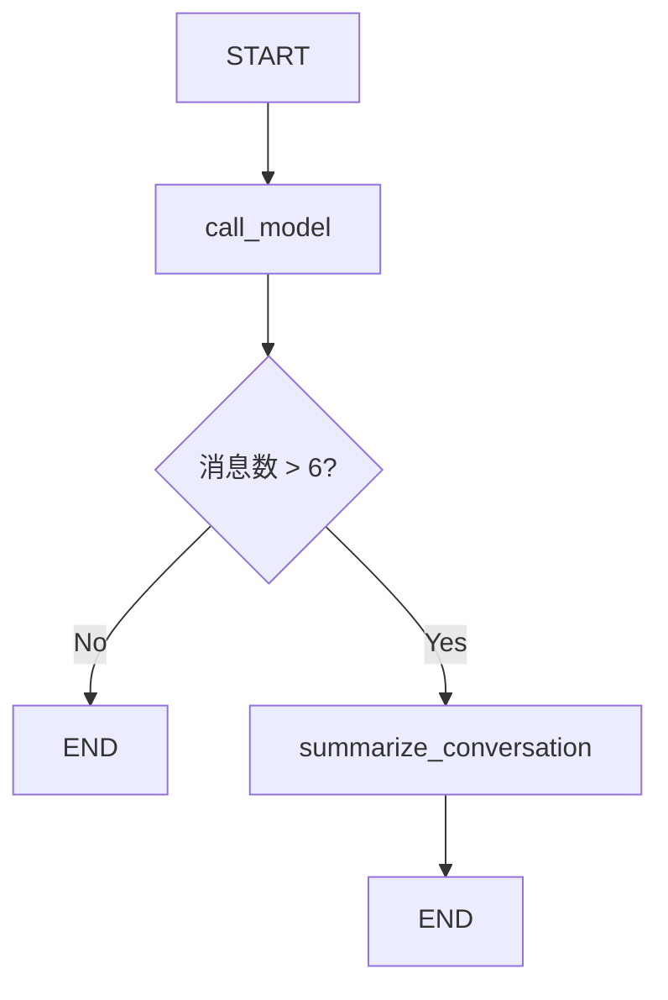

# LangGraph Chatbot with Message Summarization Detailed interpretation

## 📚 Overview

This document explains in detail the **Message Summarization** technology in LangGraph. This is an intelligent memory management scheme that uses LLM to generate conversation summaries to compress historical messages, thereby enabling long-term conversations without high token costs and latency issues.

## 🎯 Core Concept

### Why do we need conversation summaries?

When building chatbots, we face a fundamental contradiction:

1. **Long-term memory requirements**: Users expect the bot to remember the entire conversation history
2. **token restriction**: LLM has context window restrictions
3. **Cost and Latency**: Sending a large number of historical messages will increase cost and response time

### Comparison of three message management strategies

| Strategy | Advantages | Disadvantages | Applicable scenarios |
|------|------|------|---------|
| **Keep it intact** | Complete information | High token cost, may exceed limit | Short conversation |
| **Crop/Filter** | Simple and efficient | Lost historical information | Simple conversation |
| **Smart Summary** | Retain key information and control costs | High implementation complexity | Long-term dialogue |

**Solution for this tutorial:** Use LLM to generate conversation summaries, retaining compressed historical information to support long-term conversations.

---

## 🏗️ System architecture

### Core Mechanism

```
用户消息流
    ↓
检查消息数量
    ↓
├─ ≤6 条消息 → 直接使用历史
│      ↓
│  [call_model] 生成回复
│      ↓
│    END
│
└─ >6 条消息 → 触发摘要
       ↓
   [summarize_conversation] 生成/更新摘要
       ↓
   保留最新 2 条消息 + 摘要
       ↓
     END
```

### Work flow chart



---

## 🔧 Detailed explanation of code implementation

### 1. Environment settings

```python
%%capture --no-stderr
%pip install --quiet -U langchain_core langgraph langchain_openai
```

**Description:**
- `%%capture --no-stderr`: Jupyter magic command that hides installation output (but keeps errors)
- Install core dependencies: LangChain, LangGraph, OpenAI integration

```python
import os, getpass

def _set_env(var: str):
    if not os.environ.get(var):
        os.environ[var] = getpass.getpass(f"{var}: ")

_set_env("OPENAI_API_KEY")
```

**Python knowledge points: Environment variable management**

- `os.environ.get(var)`: Get the environment variable, if it does not exist, return `None`
- `getpass.getpass()`: Enter passwords securely (without showing clear text)
- This is a best practice for production environments: sensitive information is not hardcoded

---

### 2. LangSmith tracking settings

```python
_set_env("LANGSMITH_API_KEY")
os.environ["LANGSMITH_TRACING"] = "true"
os.environ["LANGSMITH_PROJECT"] = "langchain-academy"
```

**LangSmith role:**
- Track every LLM call
- Visualized execution process
- Debugging and performance analysis

---

### 3. Initialize model

```python
from langchain_openai import ChatOpenAI
model = ChatOpenAI(model="gpt-4o", temperature=0)
```

**Parameter description:**
- `model="gpt-4o"`: Use GPT-4 Optimized model
- `temperature=0`: deterministic output (suitable for tasks requiring consistency)

---

### 4. Define State⭐

This is the core of the entire system!

```python
from langgraph.graph import MessagesState

class State(MessagesState):
    summary: str
```

**LangGraph knowledge point: MessagesState**

`MessagesState` is the built-in state base class provided by LangGraph:

```python
class MessagesState(TypedDict):
    messages: Annotated[list[AnyMessage], add_messages]
```

**Key Features:**

1. **Automatic message management**: `messages` field has been configured `add_messages` reducer
2. **Smart Merge**: New messages are automatically appended to history
3. **ID Management**: Each message has a unique ID and supports deletion/update

**Our extensions:**

```python
class State(MessagesState):
    summary: str  # 新增摘要字段
```

The current status includes:
- `messages`: message list (inherited from MessagesState)
- `summary`: Conversation summary (new)

**Python knowledge points: Class inheritance**

```python
class State(MessagesState):
    # 继承 MessagesState 的所有字段和方法
    summary: str  # 添加新字段
```

This is Python’s single inheritance pattern, and `State` has:
- `messages` field of parent class
- own `summary` field

---

### 5. Dialogue node: call_model ⭐

```python
from langchain_core.messages import SystemMessage, HumanMessage, RemoveMessage

def call_model(state: State):
    # 获取摘要（如果存在）
    summary = state.get("summary", "")

    # 如果有摘要，添加到系统消息
    if summary:
        # 创建包含摘要的系统消息
        system_message = f"Summary of conversation earlier: {summary}"

        # 将摘要追加到消息历史前面
        messages = [SystemMessage(content=system_message)] + state["messages"]
    else:
        # 没有摘要，直接使用消息历史
        messages = state["messages"]

    # 调用 LLM
    response = model.invoke(messages)
    return {"messages": response}
```

**Code analysis:**

#### Step 1: Check if there is a summary

```python
summary = state.get("summary", "")
```

- `state.get("summary", "")`: Get digest safely, return empty string if not present
- Avoid `KeyError` exception

#### Step 2: Build message list

**Case A: With summary**
```python
messages = [SystemMessage(content=system_message)] + state["messages"]
```

Message structure:
```
[
    SystemMessage("Summary of conversation earlier: 用户叫 Lance，喜欢 49ers..."),
    HumanMessage("最新用户消息"),
    ...
]
```

**Case B: No Summary**
```python
messages = state["messages"]
```

Straight from the original history.

#### Step 3: Call the model and return

```python
response = model.invoke(messages)
return {"messages": response}
```

- `model.invoke(messages)`: Send message to LLM
- `return {"messages": response}`: The returned dictionary will be updated with `State.messages`

**LangGraph knowledge point: status update mechanism**

The dictionary returned by the node is automatically merged into the state:

```python
# 当前 State.messages = [msg1, msg2]
return {"messages": response}
# 更新后 State.messages = [msg1, msg2, response]
```

This is because the `add_messages` reducer appends new messages to the list.

---

### 6. Summary node: summarize_conversation ⭐⭐⭐

This is the heart of this tutorial!

```python
def summarize_conversation(state: State):
    # 第一步：获取现有摘要
    summary = state.get("summary", "")

    # 第二步：创建摘要提示
    if summary:
        # 已有摘要 → 增量更新
        summary_message = (
            f"This is summary of the conversation to date: {summary}\n\n"
            "Extend the summary by taking into account the new messages above:"
        )
    else:
        # 无摘要 → 首次创建
        summary_message = "Create a summary of the conversation above:"

    # 第三步：生成摘要
    messages = state["messages"] + [HumanMessage(content=summary_message)]
    response = model.invoke(messages)

    # 第四步：删除旧消息，只保留最新 2 条
    delete_messages = [RemoveMessage(id=m.id) for m in state["messages"][:-2]]

    return {"summary": response.content, "messages": delete_messages}
```

#### Detailed analysis

**Step 1: Check existing abstracts**

```python
summary = state.get("summary", "")
```

Determine whether it is a first summary or an updated summary.

**Step 2: Build summary prompt**

Two prompting strategies:

1. **First abstract** (no existing abstract):
   ```
   "Create a summary of the conversation above:"
   ```

2. **Incremental summary** (with existing summary):
   ```
   "This is summary of the conversation to date: {旧摘要}

   Extend the summary by taking into account the new messages above:"
   ```

**Why use incremental summaries? **
- Preserve the continuity of historical information
- Avoid repeating summaries of entire conversations
- Just process new messages

**Step 3: Call LLM to generate summary**

```python
messages = state["messages"] + [HumanMessage(content=summary_message)]
response = model.invoke(messages)
```

Message structure:
```
[
    ...历史消息...,
    HumanMessage("Create a summary of the conversation above:")
]
```

LLM generates summaries based on all history.

**Step 4: Delete old messages** ⭐

```python
delete_messages = [RemoveMessage(id=m.id) for m in state["messages"][:-2]]
```

**Key knowledge point: RemoveMessage**

`RemoveMessage` is a special message type provided by LangGraph for removing messages from the state:

```python
RemoveMessage(id=message_id)
```

**Code analysis:**

```python
state["messages"][:-2]  # 除了最后 2 条消息外的所有消息
[RemoveMessage(id=m.id) for m in ...]  # 为每条消息创建删除标记
```

**Execution effect:**

Assume there are 8 messages:
```
[msg1, msg2, msg3, msg4, msg5, msg6, msg7, msg8]
                                     ^^^^^ ^^^^^ 保留最新 2 条
^^^^^^ ^^^^^^ ^^^^^^ ^^^^^^ ^^^^^^            删除这 6 条
```

After deletion:
```
[msg7, msg8]  # 只保留最新 2 条
```

**Why keep 2 items? **
- Latest user news
- Latest AI replies
- Ensure dialogue continuity

**Step 5: Return for updates**

```python
return {
    "summary": response.content,    # 更新摘要
    "messages": delete_messages     # 删除旧消息
}
```

**LangGraph knowledge point: update multiple fields at the same time**

A node can return updates for multiple fields:
- `summary`: Store new summary text
- `messages`: Apply delete operation (`add_messages` reducer will handle `RemoveMessage`)

---

### 7. Conditional edge: should_continue

```python
from langgraph.graph import END
from typing_extensions import Literal

def should_continue(state: State) -> Literal["summarize_conversation", END]:
    """返回下一个要执行的节点"""

    messages = state["messages"]

    # 如果消息超过 6 条，进行摘要
    if len(messages) > 6:
        return "summarize_conversation"

    # 否则结束
    return END
```

**Python knowledge point: Literal type**

```python
from typing_extensions import Literal

def should_continue(state: State) -> Literal["summarize_conversation", END]:
    ...
```

`Literal` means that the return value can only be the specified literal:
- `"summarize_conversation"`: string literal
- `END`: special constants of LangGraph

**Function:**
- Type safety: IDE checks return value
- Auto-completion: IDE will prompt for possible return values

**LangGraph knowledge point: conditional edge return value**

The return value of the conditional edge function determines the next node:
- Return node name → jump to this node
- Return to `END` → End graph execution

---

### 8. Add Memory ⭐⭐⭐

**Core Issue:** By default, LangGraph's state is **temporary** and is brand new for each execution.

**Solution:** Use **Checkpointer** (checkpoint mechanism) to persist the state.

```python
from langgraph.checkpoint.memory import MemorySaver

memory = MemorySaver()
```

**MemorySaver function:**
- In-memory key-value storage
- Automatically save the status of each step
-Support multi-threaded conversations

**LangGraph knowledge point: state persistence**

```python
graph = workflow.compile(checkpointer=memory)
```

**Execution process:**

1. **Before execution**: Load the last state from checkpointer
2. **After each node**: Automatically save the current state to checkpointer
3. **After execution**: The status is retained in the checkpointer

**Why is it important? **
- Support long-term conversations: users can continue previous conversations at any time
- Interruption recovery: Even if the program is restarted, the conversation history still exists
- Multi-user isolation: conversations with different thread_ids do not interfere with each other

---

### 9. Construction diagram

```python
from IPython.display import Image, display
from langgraph.checkpoint.memory import MemorySaver
from langgraph.graph import StateGraph, START

# 定义图
workflow = StateGraph(State)

# 添加节点
workflow.add_node("conversation", call_model)
workflow.add_node(summarize_conversation)  # 函数名自动作为节点名

# 设置入口
workflow.add_edge(START, "conversation")

# 添加条件边
workflow.add_conditional_edges("conversation", should_continue)

# 摘要后结束
workflow.add_edge("summarize_conversation", END)

# 编译（带内存）
memory = MemorySaver()
graph = workflow.compile(checkpointer=memory)

# 可视化
display(Image(graph.get_graph().draw_mermaid_png()))
```

**Graph structure analysis:**

```
START
  ↓
conversation (call_model)
  ↓
should_continue (条件判断)
  ├─ ≤6 条 → END
  └─ >6 条 → summarize_conversation
              ↓
             END
```

**LangGraph knowledge point: node naming**

```python
workflow.add_node("conversation", call_model)  # 显式命名
workflow.add_node(summarize_conversation)       # 使用函数名
```

Two ways:
1. Provide name: `add_node(name, func)`
2. Automatic naming: `add_node(func)` → use the function name as the node name

---

### 10. Threads⭐⭐⭐

**Core Concept:** A Thread is a collection of related checkpoints, similar to a Slack channel.

```python
# 创建配置，指定线程 ID
config = {"configurable": {"thread_id": "1"}}
```

**The role of Thread:**

1. **Isolated conversations**: Conversations with different thread_ids do not affect each other
2. **Status Grouping**: All checkpoints in the same thread share history
3. **Multi-user support**: Each user uses an independent thread_id

**Analogy understanding:**

| Concepts | LangGraph | Slack |
|------|-----------|-------|
| Thread | thread_id | channel |
| Checkpoint | Status Snapshot | Message History |
| State | Current conversation status | Current channel content |

---

### 11. Execute dialogue

```python
# 创建线程配置
config = {"configurable": {"thread_id": "1"}}

# 第一轮对话
input_message = HumanMessage(content="hi! I'm Lance")
output = graph.invoke({"messages": [input_message]}, config)
for m in output['messages'][-1:]:
    m.pretty_print()
```

**Output:**
```
================================== Ai Message ==================================

Hello Lance! How can I assist you today?
```

**Execution process:**

1. Check whether thread "1" has history → None
2. Create a new state: `{"messages": [HumanMessage("hi! I'm Lance")]}`
3. Enter the `conversation` node
4. No summary, call LLM directly
5. Return to AI reply
6. Save state to thread "1"

---

```python
# 第二轮对话
input_message = HumanMessage(content="what's my name?")
output = graph.invoke({"messages": [input_message]}, config)
for m in output['messages'][-1:]:
    m.pretty_print()
```

**Output:**
```
================================== Ai Message ==================================

You mentioned that your name is Lance. How can I help you today?
```

**Execution process:**

1. Load historical status from thread "1":
   ```
   {"messages": [
       HumanMessage("hi! I'm Lance"),
       AIMessage("Hello Lance!...")
   ]}
   ```
2. Add new message: `HumanMessage("what's my name?")`
3. Call LLM (with full history)
4. AI can recall that the name is "Lance"
5. Save the updated state

---

```python
# 第三轮对话
input_message = HumanMessage(content="i like the 49ers!")
output = graph.invoke({"messages": [input_message]}, config)
for m in output['messages'][-1:]:
    m.pretty_print()
```

**Output:**
```
================================== Ai Message ==================================

That's great! The San Francisco 49ers have a rich history and a passionate fan base.
Do you have a favorite player or a memorable game that you particularly enjoyed?
```

**Current status:**
```
messages: [
    HumanMessage("hi! I'm Lance"),
    AIMessage("Hello Lance!..."),
    HumanMessage("what's my name?"),
    AIMessage("You mentioned that your name is Lance..."),
    HumanMessage("i like the 49ers!"),
    AIMessage("That's great! The San Francisco 49ers...")
]
summary: ""  # 还未触发摘要
```

At this point there are **6 messages** and the threshold to trigger the summary (>6) has not yet been reached.

---

### 12. Check summary status

```python
graph.get_state(config).values.get("summary", "")
```

**Output:**
```
''
```

**LangGraph knowledge point: get_state API**

```python
state_snapshot = graph.get_state(config)
state_snapshot.values  # 获取当前状态的所有值
```

Return `StateSnapshot` object:
- `values`: current status dictionary
- `next`: The next node to be executed
- `config`: Configuration information
- `metadata`: metadata

---

### 13. Trigger Summary

```python
# 第四轮对话（触发摘要）
input_message = HumanMessage(content="i like Nick Bosa, isn't he the highest paid defensive player?")
output = graph.invoke({"messages": [input_message]}, config)
for m in output['messages'][-1:]:
    m.pretty_print()
```

**Output:**
```
================================== Ai Message ==================================

Yes, as of September 2023, Nick Bosa became the highest-paid defensive player in NFL history.
He signed a five-year contract extension with the San Francisco 49ers worth $170 million,
with $122.5 million guaranteed. Bosa is known for his exceptional skills as a defensive end
and has been a key player for the 49ers.
```

**Execution process:**

1. Load history (6 messages)
2. Add new messages → **7 messages**
3. Enter the `conversation` node and generate a reply
4. There are now **8 messages** → trigger condition `len(messages) > 6`
5. `should_continue` Return `"summarize_conversation"`
6. Enter the `summarize_conversation` node:
   - Generate summary
   - Delete first 6 messages
   - Keep the latest 2 items
7. Status update:
   ```
   messages: [最新 2 条消息]
   summary: "Lance introduced himself and mentioned..."
   ```

---

### 14. View the generated summary

```python
graph.get_state(config).values.get("summary", "")
```

**Output:**
```
'Lance introduced himself and mentioned that he is a fan of the San Francisco 49ers,
specifically highlighting his admiration for Nick Bosa. The conversation noted that
as of September 2023, Nick Bosa became the highest-paid defensive player in NFL history
with a five-year, $170 million contract extension with the 49ers.'
```

**Abstract Content Analysis:**

✅ Information included:
- Username: Lance
- Hobbies: 49ers fans
- Favorite player: Nick Bosa
- Factual information: Nick Bosa’s contract details

✅ Compression effect:
- Original: 8 messages (hundreds of tokens)
- Abstract: 1 paragraph of text (about 50 tokens)
- Compression ratio: about 80-90%

---

## 🎓 Summary of core knowledge points

### LangGraph-specific concepts

#### 1. MessagesState

**Built-in state base class**, providing out-of-the-box message management:

```python
from langgraph.graph import MessagesState

class State(MessagesState):
    # 自动拥有 messages 字段
    summary: str  # 添加自定义字段
```

**Features:**
- `messages` field preconfiguration `add_messages` reducer
- Support message addition, update, and deletion
- Automatically manage message IDs

#### 2. RemoveMessage

**Mechanism for deleting messages**:

```python
from langchain_core.messages import RemoveMessage

# 删除特定消息
delete_messages = [RemoveMessage(id=m.id) for m in old_messages]
return {"messages": delete_messages}
```

**How it works:**
- `add_messages` reducer identifies `RemoveMessage`
- Remove the message corresponding to the ID from the status
-Support batch deletion

#### 3. Checkpointer

**Mechanism of persistent state**:

```python
from langgraph.checkpoint.memory import MemorySaver

memory = MemorySaver()
graph = workflow.compile(checkpointer=memory)
```

**Function:**
- Automatically save status snapshots at each step
- Support status recovery and continuation
- Implement long-term memory

#### 4. Thread

**Status Grouping and Isolation**:

```python
config = {"configurable": {"thread_id": "1"}}
graph.invoke(input, config)
```

**Features:**
- Independent state space for each thread
-Isolate different conversations by thread_id
- Database-like session concept

#### 5. Flexible return of conditional edges

```python
from typing_extensions import Literal

def should_continue(state: State) -> Literal["next_node", END]:
    if condition:
        return "next_node"
    return END
```

**Return value type:**
- node name (string)
- `END` (special constant)
- Lists or other complex logic

---

### Python-specific knowledge points

#### 1. TypedDict inheritance

```python
from langgraph.graph import MessagesState

class State(MessagesState):
    summary: str
```

**Note:** `TypedDict` supports inheritance, and the subclass has all the fields of the parent class.

#### 2. Dictionary get method

```python
summary = state.get("summary", "")
#                  ^^^^^^^^^  ^^^^
#                  键名        默认值
```

**Avoid KeyError**:
- key exists → return value
- key does not exist → return to default value

#### 3. List slicing

```python
state["messages"][:-2]  # 除了最后 2 个元素的所有元素
#                 ^^^^
#                 负索引切片
```

| slice | meaning |
|------|------|
| `[:-2]` | From the beginning to the third from the bottom |
| `[-2:]` | Last 2 |
| `[2:-2]` | 3rd to 3rd from the bottom |

#### 4. List comprehension

```python
delete_messages = [RemoveMessage(id=m.id) for m in state["messages"][:-2]]
```

**Equivalent to:**
```python
delete_messages = []
for m in state["messages"][:-2]:
    delete_messages.append(RemoveMessage(id=m.id))
```

#### 5. f-string multi-line string

```python
summary_message = (
    f"This is summary of the conversation to date: {summary}\n\n"
    "Extend the summary by taking into account the new messages above:"
)
```

**Python features:**
- Multi-line strings in brackets will be automatically concatenated
- Can mix f-strings and normal strings

---

## 💡 Best Practices

### 1. Summary triggering strategy

#### Option A: Based on the number of messages (this tutorial)

```python
def should_continue(state: State):
    if len(state["messages"]) > 6:
        return "summarize_conversation"
    return END
```

✅ **Benefits:** Simple and predictable
❌ **Disadvantages:** Does not consider message length

#### Option B: Based on the number of Tokens

```python
def should_continue(state: State):
    total_tokens = sum(len(m.content.split()) for m in state["messages"])
    if total_tokens > 1000:
        return "summarize_conversation"
    return END
```

✅ **Benefits:** More precise cost control
❌ **Disadvantages:** Computational overhead

#### Solution C: Time-based

```python
def should_continue(state: State):
    # 假设 messages 有 timestamp 字段
    oldest = state["messages"][0].timestamp
    newest = state["messages"][-1].timestamp
    if (newest - oldest).days > 1:
        return "summarize_conversation"
    return END
```

✅ **Advantages:** Suitable for long-term conversations
❌ **Disadvantages:** Requires additional timestamp management

---

### 2. Digest retention policy

#### Current implementation: keep the latest 2 items

```python
delete_messages = [RemoveMessage(id=m.id) for m in state["messages"][:-2]]
```

**Applicable scenarios:** General conversation

#### Option B: Keep the latest N items

```python
KEEP_LAST_N = 4
delete_messages = [RemoveMessage(id=m.id) for m in state["messages"][:-KEEP_LAST_N]]
```

**Applicable scenarios:** Conversations that require more context

#### Solution C: Keep important messages

```python
def is_important(message):
    # 自定义重要性判断逻辑
    return "重要" in message.content or message.type == "system"

delete_messages = [
    RemoveMessage(id=m.id)
    for m in state["messages"]
    if not is_important(m)
]
```

**Applicable scenarios:** Key information needs to be retained

---

### 3. Summary quality optimization

#### Tip 1: Structured summary tips

```python
summary_prompt = """
Summarize the conversation with the following structure:
- User profile: Name, preferences, interests
- Key topics discussed: Main themes
- Important facts: Specific details mentioned
- Action items: Any pending tasks

Current summary: {summary}
New messages: {messages}
"""
```

#### Tip 2: Incremental Summary

```python
if summary:
    # 告诉 LLM 只更新新信息
    prompt = f"Current summary: {summary}\n\nUpdate ONLY with new information from above messages."
else:
    prompt = "Create a comprehensive summary of the conversation."
```

#### Tip 3: Digest Verification

```python
def summarize_conversation(state: State):
    # 生成摘要
    response = model.invoke(messages)
    summary = response.content

    # 验证摘要质量（可选）
    if len(summary) < 50:
        # 摘要太短，重新生成
        prompt = "Create a MORE DETAILED summary..."
        response = model.invoke(prompt)
        summary = response.content

    # ...
```

---

### 4. Memory management strategy

#### Development environment: MemorySaver

```python
from langgraph.checkpoint.memory import MemorySaver
memory = MemorySaver()  # 内存存储，重启丢失
```

✅ **Advantages:** Simple and fast
❌ **Disadvantages:** Not persistent

#### Production environment: SqliteSaver

```python
from langgraph.checkpoint.sqlite import SqliteSaver
memory = SqliteSaver.from_conn_string("checkpoints.db")
```

✅ **Advantages:** Persistence to disk
✅ **Applicable:** Stand-alone application

#### Distributed environment: RedisSaver (custom)

```python
# 需要自己实现或使用第三方库
from langgraph.checkpoint.redis import RedisSaver
memory = RedisSaver(redis_url="redis://localhost:6379")
```

✅ **Advantages:** Supports distributed and high performance
✅ **Applicable:** Multi-instance deployment

---

### 5. Thread management best practices

#### Strategy 1: Based on User ID

```python
def get_config(user_id: str):
    return {"configurable": {"thread_id": f"user_{user_id}"}}

# 使用
config = get_config("alice")
graph.invoke(input, config)
```

#### Strategy 2: Based on session ID

```python
import uuid

def create_session():
    session_id = str(uuid.uuid4())
    return {"configurable": {"thread_id": session_id}}

# 新会话
config = create_session()
```

#### Strategy 3: Multi-dimensional isolation

```python
def get_config(user_id: str, conversation_id: str):
    thread_id = f"{user_id}_{conversation_id}"
    return {"configurable": {"thread_id": thread_id}}

# 使用
config = get_config("alice", "project_discussion")
```

---

## 🚀 Advanced skills

### 1. Multi-level summary

For very long conversations, multi-level summaries can be implemented:

```python
class State(MessagesState):
    recent_summary: str      # 最近几轮的摘要
    long_term_summary: str   # 长期总结

def should_summarize(state: State):
    msg_count = len(state["messages"])
    if msg_count > 20:
        return "create_long_term_summary"
    elif msg_count > 6:
        return "create_recent_summary"
    return END
```

**Structure:**
```
最新消息 (2-6 条)
    ↓
recent_summary (压缩最近 10-20 轮)
    ↓
long_term_summary (压缩整个对话历史)
```

---

### 2. Topic-driven abstracts

```python
class State(MessagesState):
    summary_by_topic: dict[str, str]  # 按主题分类的摘要

def summarize_conversation(state: State):
    # 先提取主题
    topics = extract_topics(state["messages"])

    # 为每个主题生成摘要
    summaries = {}
    for topic in topics:
        topic_messages = filter_by_topic(state["messages"], topic)
        summary = create_summary(topic_messages)
        summaries[topic] = summary

    return {"summary_by_topic": summaries}
```

---

### 3. Smart summary trigger

Decide whether to summarize based on the dynamic content of the conversation:

```python
def should_continue(state: State):
    messages = state["messages"]

    # 检查是否有话题转换
    if detect_topic_change(messages):
        return "summarize_conversation"

    # 检查是否有重要信息
    if has_important_info(messages):
        return "summarize_conversation"

    # 否则根据长度判断
    if len(messages) > 6:
        return "summarize_conversation"

    return END
```

---

### 4. Compare the abstract with the original text

Provide access to the original text while retaining the abstract:

```python
class State(MessagesState):
    summary: str
    archived_messages: list  # 被摘要的原始消息

def summarize_conversation(state: State):
    summary_response = model.invoke(...)

    # 归档被删除的消息
    archived = state["messages"][:-2]
    delete_messages = [RemoveMessage(id=m.id) for m in archived]

    return {
        "summary": summary_response.content,
        "archived_messages": archived,
        "messages": delete_messages
    }
```

**Use:**
- Debugging and auditing
- Users can view the original conversation
- Summary quality assessment

---

## 📊Performance optimization

### 1. Token cost analysis

**No summary (full history):**
```
轮次 1: 10 tokens (输入) + 20 tokens (输出) = 30 tokens
轮次 2: 30 tokens (输入) + 20 tokens (输出) = 50 tokens
轮次 3: 50 tokens (输入) + 20 tokens (输出) = 70 tokens
...
轮次 10: 210 tokens (输入) + 20 tokens (输出) = 230 tokens

总计: 约 1300 tokens
```

**With summary:**
```
轮次 1-3: 同上 (150 tokens)
轮次 4: 触发摘要
  - 摘要生成: 70 tokens (输入) + 50 tokens (摘要) = 120 tokens
轮次 5: 50 tokens (摘要) + 20 tokens (新消息) + 20 tokens (输出) = 90 tokens
...
轮次 10: 类似轮次 5

总计: 约 800 tokens (节省 38%)
```

### 2. Latency optimization

#### Option A: Asynchronous summary

```python
# 当前：同步摘要（阻塞用户）
conversation → (6条消息后) → summarize → 返回

# 优化：异步摘要（不阻塞）
conversation → 返回
             ↓ (后台)
           summarize (下次对话前完成)
```

#### Option B: Batch summary

```python
# 每 N 轮对话才触发一次摘要
def should_continue(state: State):
    if len(state["messages"]) > 6 and len(state["messages"]) % 10 == 0:
        return "summarize_conversation"
    return END
```

---

## 🔍 Frequently Asked Questions

### Q1: Why use `state.get("summary", "")` instead of `state["summary"]`?

**A:** Prevent `KeyError`.

- On first run, there is no `summary` field in the status
- `state["summary"]` will throw an exception
- `state.get("summary", "")` returns to the default value `""`

### Q2: Will RemoveMessage really delete the data?

**A:** Depends on Checkpointer.

- `MemorySaver`: only deleted from the current state, historical snapshots remain
- `SqliteSaver`: also retain historical snapshots
- Historical status can be accessed via `get_state_history()`

### Q3: What if the summary node fails?

**Answer:** Error handling can be added:

```python
def summarize_conversation(state: State):
    try:
        # 摘要逻辑
        response = model.invoke(messages)
        # ...
        return {"summary": response.content, "messages": delete_messages}
    except Exception as e:
        # 失败时不删除消息，保留原状态
        print(f"Summarization failed: {e}")
        return {}  # 返回空字典，状态不变
```

### Q4: Can different digest strategies be used for different threads?

**Answer:** Yes! Store the policy in state:

```python
class State(MessagesState):
    summary: str
    summary_threshold: int = 6  # 可配置

def should_continue(state: State):
    threshold = state.get("summary_threshold", 6)
    if len(state["messages"]) > threshold:
        return "summarize_conversation"
    return END

# 使用时
config = {
    "configurable": {"thread_id": "user_1"}
}
graph.invoke({
    "messages": [HumanMessage("...")],
    "summary_threshold": 10  # 这个用户用更高的阈值
}, config)
```

### Q5: How to preserve the structure of the message (such as role, timestamp) in the summary?

**Answer:** Use structured snippets:

```python
from pydantic import BaseModel

class StructuredSummary(BaseModel):
    user_info: str
    topics: list[str]
    key_facts: list[str]
    timestamp: str

def summarize_conversation(state: State):
    response = model.with_structured_output(StructuredSummary).invoke(prompt)
    # response 是 StructuredSummary 对象
    summary_json = response.json()
    return {"summary": summary_json, "messages": delete_messages}
```

---

## 🎯 Practical application cases

### Case 1: Customer service robot

**Requirements:** Support long-term customer service conversations and remember user problems and solutions.

```python
class CustomerServiceState(MessagesState):
    summary: str
    customer_info: dict  # 客户信息
    issues: list[str]    # 问题列表

def summarize_conversation(state: State):
    # 提取客户信息和问题
    prompt = """
    Summarize this customer service conversation:
    - Customer name and contact
    - Issues reported
    - Solutions provided
    - Pending actions
    """
    # ...
```

### Case 2: Educational tutoring robot

**Requirements:** Record students' learning progress and understanding.

```python
class TutoringState(MessagesState):
    summary: str
    student_progress: dict  # 学习进度
    weak_areas: list[str]   # 薄弱环节

def summarize_conversation(state: State):
    prompt = """
    Summarize the tutoring session:
    - Topics covered
    - Student's understanding level
    - Areas needing improvement
    - Homework assigned
    """
    # ...
```

### Case 3: Project Management Assistant

**Requirement:** Track project discussions and decisions.

```python
class ProjectState(MessagesState):
    summary: str
    decisions: list[str]     # 决策记录
    action_items: list[str]  # 待办事项

def summarize_conversation(state: State):
    prompt = """
    Summarize the project discussion:
    - Decisions made
    - Action items and owners
    - Blockers identified
    - Next steps
    """
    # ...
```

---

## 📖 Further reading

- [LangGraph Checkpointer official document](https://langchain-ai.github.io/langgraph/concepts/persistence/)
- [MessagesState API Reference](https://langchain-ai.github.io/langgraph/concepts/low_level/#messagesstate)
- [RemoveMessage detailed description](https://langchain-ai.github.io/langgraph/how-tos/memory/delete-messages/)
- [Memory Management Best Practices](https://langchain-ai.github.io/langgraph/how-tos/memory/)

---

## Summarize

Through this tutorial we learned:

✅ **Core Technology:**
- Use LLM to generate conversation summaries
- `RemoveMessage` Delete old messages
- `MessagesState` simplifies status management
- Checkpointer implements persistence
- Thread isolates different conversations

✅ **Key Benefits:**
- Support long-term conversations without exceeding token limits
- Intelligent compression of history to retain key information
- Cost optimization (reducing token usage by 30-50%)
- User experience improvement (remember complete conversation history)

✅ **Best Practices:**
- Select summary triggering strategy based on application scenarios
- Use structured snippets to retain important information
- Reasonably configure the number of retained messages
- Choose the appropriate Checkpointer implementation

This is a key technology for building production-grade dialogue systems! 🚀