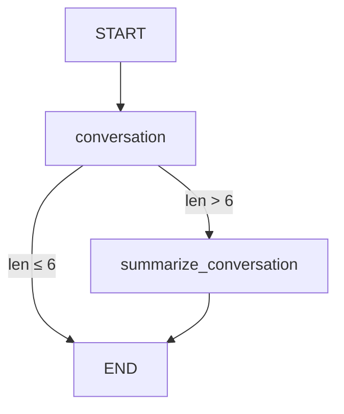

# Chatbot with External Memory Detailed interpretation

## 📚 Overview

This document explains in detail the implementation of a chatbot with external database persistent storage in LangGraph. This is the advanced content of Module 2. Based on the previous learning of message summary and memory management, **external database** is further introduced to achieve permanent conversation memory.

**Core Highlights:**
- Use SQLite database to persist conversation state
- Implement dialogue memory across sessions
- Optimize long conversation processing combined with message digests
- Supports multi-threaded independent conversation management

---

## 🎯 Core Concept

### Why do we need an external database?

In previous lessons, we learned about memory storage using MemorySaver:

```python
# 内存存储 - 程序重启后数据丢失
from langgraph.checkpoint.memory import MemorySaver
memory = MemorySaver()
```

**Limitations of memory storage:**
- ❌ All conversation history will be lost after restarting the program
- ❌ Unable to share state between different server instances
- ❌ Not suitable for production environment
- ❌ Unable to perform data analysis and auditing

**Advantages of external databases:**
- ✅ Persistent storage, no data loss after restart
- ✅ Support distributed deployment
- ✅ Can perform data analysis
- ✅ Suitable for production environment
- ✅ Support backup and recovery

### What is Checkpointer?

**Checkpointer** is the component in LangGraph responsible for saving and loading state.

```
用户消息 → 图执行 → 状态更新 → Checkpointer 保存
                                      ↓
重新执行 ← 状态加载 ← Checkpointer 读取
```

**Checkpointers supported by LangGraph:**

| Checkpointer | Storage location | Persistence | Applicable scenarios |
|--------------|---------|--------|---------|
| `MemorySaver` | Process Memory | ❌ | Development/Testing |
| `SqliteSaver` | SQLite database | ✅ | Small and medium-sized applications |
| `PostgresSaver` | PostgreSQL | ✅ | Enterprise-level application |

---

## 🎭 Practical case: Chatbot with summary and persistence

We will build a complete chatbot system with the following features:

1. **Automatic Summary**: Automatically generate a summary when the conversation exceeds 6 messages
2. **Message Pruning**: Keep the latest 2 messages + summary
3. **Persistent Storage**: Use SQLite to save all states
4. **Cross-session memory**: Conversations can still be restored after restarting the program

### System architecture diagram

```
用户输入
   ↓
[conversation] 节点
   ↓
检查消息数量
   ↓
超过 6 条？
   ├─ 是 → [summarize_conversation] → 生成摘要 + 删除旧消息
   └─ 否 → END
   ↓
状态保存到 SQLite
```

---

## 🔧 Environment preparation

### 1. Install dependencies

```python
%%capture --no-stderr
%pip install --quiet -U langgraph-checkpoint-sqlite langchain_core langgraph langchain_openai
```

**Package Description:**
- `langgraph-checkpoint-sqlite`: SQLite checkpointer support
- `langchain_core`: core message types and tools
- `langgraph`: graph construction framework
- `langchain_openai`: OpenAI model integration

### 2. Configure API Key

```python
import os, getpass

def _set_env(var: str):
    if not os.environ.get(var):
        os.environ[var] = getpass.getpass(f"{var}: ")

_set_env("OPENAI_API_KEY")
```

**Python knowledge point: getpass module**

`getpass` is used to securely enter sensitive information (such as passwords, API Keys):

```python
import getpass

# 输入时不会显示字符
password = getpass.getpass("请输入密码: ")

# 等价于但更安全：
# password = input("请输入密码: ")  # ❌ 会显示输入内容
```

---

## 🗄️ SQLite Checkpointer detailed explanation

### 1. Introduction to SQLite

**SQLite** is a lightweight embedded database:
- No separate database server required
- The entire database is stored in a single file
- Excellent performance and widely used (called "super popular" by Andrej Karpathy)
- Python built-in support

### 2. Create an in-memory database

```python
import sqlite3

# 创建内存数据库（程序结束后消失）
conn = sqlite3.connect(":memory:", check_same_thread=False)
```

**Parameter description:**
- `:memory:`: special string, create in-memory database
- `check_same_thread=False`: Allow multi-threaded access (required by LangGraph)

### 3. Create a persistent database

```python
# 下载示例数据库（如果不存在）
!mkdir -p state_db && [ ! -f state_db/example.db ] && wget -P state_db https://github.com/langchain-ai/langchain-academy/raw/main/module-2/state_db/example.db

# 连接到本地数据库文件
db_path = "state_db/example.db"
conn = sqlite3.connect(db_path, check_same_thread=False)
```

**Detailed explanation of Bash commands:**

```bash
mkdir -p state_db
# mkdir -p: 创建目录，-p 表示如果父目录不存在则创建，已存在也不报错

[ ! -f state_db/example.db ]
# [ ]: 条件测试
# -f: 检查文件是否存在
# !: 取反，即"文件不存在"

&&
# 逻辑与，前面的命令成功才执行后面的

wget -P state_db https://...
# wget: 下载文件
# -P state_db: 保存到 state_db 目录
```

### 4. Create SqliteSaver

```python
from langgraph.checkpoint.sqlite import SqliteSaver

# 创建 checkpointer
memory = SqliteSaver(conn)
```

**The role of SqliteSaver:**
- Automatically create necessary database tables
- Save the status of each step of the graph (checkpoint)
-Support status query and recovery
- Manage multiple conversation threads

**Database structure (simplified):**

```sql
CREATE TABLE checkpoints (
    thread_id TEXT,      -- 对话线程 ID
    checkpoint_id TEXT,  -- 检查点 ID
    state BLOB,          -- 序列化的状态数据
    timestamp DATETIME   -- 时间戳
);
```

---

## 🧩 Define chatbot status and logic

### 1. Import dependencies

```python
from langchain_openai import ChatOpenAI
from langchain_core.messages import SystemMessage, HumanMessage, RemoveMessage

from langgraph.graph import END
from langgraph.graph import MessagesState

model = ChatOpenAI(model="gpt-4o", temperature=0)
```

### 2. Define status Schema

```python
class State(MessagesState):
    summary: str
```

**LangGraph knowledge point: State inheritance**

```python
# MessagesState 是 LangGraph 提供的基础状态类
# 包含一个 messages 字段（带 add_messages reducer）

class MessagesState(TypedDict):
    messages: Annotated[list[BaseMessage], add_messages]

# 我们的 State 继承它，并添加 summary 字段
class State(MessagesState):
    summary: str  # 对话摘要
```

**Field description:**
- `messages`: message list (inherited from MessagesState)
- `summary`: Conversation summary (new field)

### 3. call_model node

```python
def call_model(state: State):
    # 获取摘要（如果存在）
    summary = state.get("summary", "")

    # 如果有摘要，将其添加到系统消息中
    if summary:
        system_message = f"Summary of conversation earlier: {summary}"
        messages = [SystemMessage(content=system_message)] + state["messages"]
    else:
        messages = state["messages"]

    # 调用 LLM
    response = model.invoke(messages)
    return {"messages": response}
```

**Detailed logic explanation:**

**Step 1: Check for summary**
```python
summary = state.get("summary", "")
# .get(key, default) - 如果 key 不存在返回 default
```

**Step 2: Build a message list**

If there is a summary:
```python
messages = [
    SystemMessage("Summary of conversation earlier: ..."),  # 摘要作为系统消息
    HumanMessage("hi! I'm Lance"),                         # 原始消息
    AIMessage("Hello Lance!"),
    # ... 更多消息
]
```

If there is no summary:
```python
messages = [
    HumanMessage("hi! I'm Lance"),
    AIMessage("Hello Lance!"),
    # ... 所有原始消息
]
```

**Step 3: Call LLM and return**
```python
response = model.invoke(messages)
return {"messages": response}
# LangGraph 会自动将 response 添加到 state["messages"]
```

### 4. summarize_conversation node

```python
def summarize_conversation(state: State):
    # 获取现有摘要
    summary = state.get("summary", "")

    # 创建摘要提示词
    if summary:
        # 已有摘要，需要扩展
        summary_message = (
            f"This is summary of the conversation to date: {summary}\n\n"
            "Extend the summary by taking into account the new messages above:"
        )
    else:
        # 首次创建摘要
        summary_message = "Create a summary of the conversation above:"

    # 添加提示词到消息历史
    messages = state["messages"] + [HumanMessage(content=summary_message)]
    response = model.invoke(messages)

    # 删除除最近 2 条以外的所有消息
    delete_messages = [RemoveMessage(id=m.id) for m in state["messages"][:-2]]

    return {"summary": response.content, "messages": delete_messages}
```

**LangGraph knowledge point: RemoveMessage**

`RemoveMessage` is a special message type provided by LangGraph for removing messages from the state:

```python
# 创建删除指令
RemoveMessage(id=message.id)

# 批量删除示例
messages = state["messages"]  # 假设有 10 条消息
delete_messages = [RemoveMessage(id=m.id) for m in messages[:-2]]
# 删除前 8 条，保留最后 2 条
```

**Execution process diagram:**

**Assume current status:**
```python
messages = [
    msg1,  # id=1
    msg2,  # id=2
    msg3,  # id=3
    msg4,  # id=4
    msg5,  # id=5
    msg6,  # id=6
    msg7,  # id=7
]
```

**After executive summary:**
```python
# 1. 生成摘要
summary = "Lance 介绍自己，喜欢 49ers..."

# 2. 创建删除指令（保留最后 2 条）
delete_messages = [
    RemoveMessage(id=1),
    RemoveMessage(id=2),
    RemoveMessage(id=3),
    RemoveMessage(id=4),
    RemoveMessage(id=5),
]

# 3. 返回更新
return {
    "summary": summary,
    "messages": delete_messages
}

# 4. 最终状态
messages = [msg6, msg7]  # 只保留最后 2 条
summary = "Lance 介绍自己，喜欢 49ers..."
```

**Python knowledge points: list slicing**

```python
messages = [1, 2, 3, 4, 5]

messages[-2:]   # [4, 5]  - 最后 2 个元素
messages[:-2]   # [1, 2, 3]  - 除最后 2 个外的所有元素
messages[:2]    # [1, 2]  - 前 2 个元素
messages[2:]    # [3, 4, 5]  - 从第 3 个开始的所有元素
```

### 5. should_continue conditional function

```python
def should_continue(state: State):
    """返回下一个要执行的节点"""

    messages = state["messages"]

    # 如果消息超过 6 条，执行摘要
    if len(messages) > 6:
        return "summarize_conversation"

    # 否则结束
    return END
```

**LangGraph knowledge point: conditional edge return value**

Conditional functions can return:
1. **Node name string**: `"summarize_conversation"`
2. **END constant**: End graph execution
3. **Multiple possible node names (used with mapping)**

```python
# 示例 1：简单条件
def should_continue(state):
    if condition:
        return "node_a"
    return END

# 示例 2：多路分支
def route(state):
    if state["score"] > 0.8:
        return "high_quality"
    elif state["score"] > 0.5:
        return "medium_quality"
    return "low_quality"
```

---

## 🏗️ Construction diagram

### 1. Define graph structure

```python
from IPython.display import Image, display
from langgraph.graph import StateGraph, START

# 创建图
workflow = StateGraph(State)

# 添加节点
workflow.add_node("conversation", call_model)
workflow.add_node(summarize_conversation)  # 函数名 = 节点名

# 定义边
workflow.add_edge(START, "conversation")
workflow.add_conditional_edges("conversation", should_continue)
workflow.add_edge("summarize_conversation", END)

# 编译（关键！使用 SQLite checkpointer）
graph = workflow.compile(checkpointer=memory)

# 可视化
display(Image(graph.get_graph().draw_mermaid_png()))
```

**LangGraph knowledge point: two ways to add_node**

```python
# 方式 1：指定节点名
workflow.add_node("conversation", call_model)
#                  ^^^^^^^^^^^^^  ^^^^^^^^^^
#                  节点名           函数

# 方式 2：自动使用函数名作为节点名
workflow.add_node(summarize_conversation)
# 等价于：
# workflow.add_node("summarize_conversation", summarize_conversation)
```

**Graph structure visualization:**



### 2. Specify Checkpointer when compiling

```python
graph = workflow.compile(checkpointer=memory)
#                        ^^^^^^^^^^^^^^^^^^^
#                        关键！启用状态持久化
```

**Without checkpointer vs with checkpointer:**

| Features | Without checkpointer | With checkpointer |
|------|----------------|----------------|
| Status Saving | ❌ No Saving | ✅ Automatically save every step |
| Dialogue memory | ❌ None | ✅ Supports multiple rounds of dialogue |
| Restart recovery | ❌ Not possible | ✅ Recoverable |
| thread_id | ❌ meaningless | ✅ required |

---

## 🚀 Run chatbot

### 1. Create a conversation thread

```python
# 配置：指定线程 ID
config = {"configurable": {"thread_id": "1"}}
```

**LangGraph knowledge point: Thread (thread)**

**Thread** is the conversational session concept in LangGraph:

```python
# 不同的 thread_id = 不同的对话会话
config_user1 = {"configurable": {"thread_id": "user_123"}}
config_user2 = {"configurable": {"thread_id": "user_456"}}

# 它们的状态完全独立
graph.invoke({"messages": [...]}, config_user1)  # 用户1的对话
graph.invoke({"messages": [...]}, config_user2)  # 用户2的对话
```

**Actual application scenario:**
- Multi-user chatbot (one thread_id per user)
- A/B testing (different thread_ids are used for different configurations)
- Multi-turn dialogue management

### 2. Execute multiple rounds of dialogue

```python
# 第 1 轮
input_message = HumanMessage(content="hi! I'm Lance")
output = graph.invoke({"messages": [input_message]}, config)
for m in output['messages'][-1:]:
    m.pretty_print()

# 第 2 轮
input_message = HumanMessage(content="what's my name?")
output = graph.invoke({"messages": [input_message]}, config)
for m in output['messages'][-1:]:
    m.pretty_print()

# 第 3 轮
input_message = HumanMessage(content="i like the 49ers!")
output = graph.invoke({"messages": [input_message]}, config)
for m in output['messages'][-1:]:
    m.pretty_print()
```

**Example output:**

```
================================== Ai Message ==================================

Hello again, Lance! It's great to hear from you. Since you like the 49ers, is there a particular player or moment in their history that stands out to you?

================================== Ai Message ==================================

Your name is Lance! How can I assist you today? Would you like to talk more about the San Francisco 49ers or something else?

================================== Ai Message ==================================

That's awesome, Lance! The San Francisco 49ers have a rich history and a passionate fan base. Is there a specific aspect of the team you'd like to discuss?
```

**Python knowledge point: List slicing takes the last element**

```python
output['messages'][-1:]   # 返回列表 [最后一条消息]
output['messages'][-1]    # 返回单个消息对象

# 为什么用 [-1:] 而不是 [-1]？
# 因为 pretty_print() 可以处理列表，统一接口
```

**Conversation Analysis:**

| Rounds | User Input | AI Reply | Description |
|------|---------|---------|------|
| 1 | "hi! I'm Lance" | "Hello again, Lance!" | AI remembers names |
| 2 | "what's my name?" | "Your name is Lance!" | Memories from history |
| 3 | "i like the 49ers!" | "That's awesome, Lance!" | Contextual coherence |

---

## 💾 View and restore status

### 1. View current status

```python
config = {"configurable": {"thread_id": "1"}}
graph_state = graph.get_state(config)
graph_state
```

**Output (StateSnapshot object):**

```python
StateSnapshot(
    values={
        'messages': [
            HumanMessage(content="hi! I'm Lance", id='d5bb4b3f-...'),
            AIMessage(content="Hello again, Lance! ...", id='run-dde04d51-...'),
            HumanMessage(content="what's my name?", id='d7530770-...'),
            AIMessage(content='Your name is Lance! ...', id='run-763b6387-...'),
            HumanMessage(content='i like the 49ers!', id='235dcec4-...'),
            AIMessage(content="That's awesome, Lance! ...", id='run-729860b2-...')
        ],
        'summary': 'Lance introduced himself multiple times...'
    },
    next=(),
    config={
        'configurable': {
            'thread_id': '1',
            'checkpoint_ns': '',
            'checkpoint_id': '1ef6a36d-ca9c-6144-801b-6d0cf97adc73'
        }
    },
    metadata={
        'source': 'loop',
        'writes': {...},
        'step': 27,
        'parents': {}
    },
    created_at='2024-09-03T20:55:33.466540+00:00',
    parent_config={...},
    tasks=()
)
```

**Detailed explanation of StateSnapshot field:**

| Field | Description | Sample Value |
|------|------|--------|
| `values` | All data in current status | `{"messages": [...], "summary": "..."}` |
| `next` | The node to be executed next | `()` means it has ended |
| `config` | Configuration information (including checkpoint_id) | `{"thread_id": "1", "checkpoint_id": "..."}` |
| `metadata` | Metadata (number of steps, source, etc.) | `{"step": 27, "source": "loop"}` |
| `created_at` | Creation time | `"2024-09-03T20:55:33..."` |

### 2. Persistence verification

**Key feature: The status remains after restarting the notebook! **

```python
# 重启 Jupyter kernel 后重新运行

# 重新连接数据库
db_path = "state_db/example.db"
conn = sqlite3.connect(db_path, check_same_thread=False)
memory = SqliteSaver(conn)

# 重新编译图
graph = workflow.compile(checkpointer=memory)

# 查询状态 - 数据仍然存在！
config = {"configurable": {"thread_id": "1"}}
graph_state = graph.get_state(config)
graph_state  # 返回之前的对话历史
```

**Why can it be restored? **

```
程序运行时：
  状态 → SqliteSaver → SQLite 文件 (state_db/example.db)

程序重启：
  SQLite 文件依然存在 → SqliteSaver 读取 → 恢复状态
```

**Compare memory storage:**

```python
# MemorySaver - 重启后丢失
memory = MemorySaver()
graph = workflow.compile(checkpointer=memory)
# 重启后 graph_state 为空

# SqliteSaver - 重启后保留
memory = SqliteSaver(conn)
graph = workflow.compile(checkpointer=memory)
# 重启后 graph_state 仍然存在
```

---

## 🎓 Summary of core knowledge points

### LangGraph-specific concepts

#### 1. Checkpointer

**Definition:** Component responsible for saving and loading graph state

**Type comparison:**

```python
# 内存存储（开发用）
from langgraph.checkpoint.memory import MemorySaver
memory = MemorySaver()

# SQLite 存储（生产小规模）
from langgraph.checkpoint.sqlite import SqliteSaver
memory = SqliteSaver(conn)

# PostgreSQL 存储（企业级）
from langgraph.checkpoint.postgres import PostgresSaver
memory = PostgresSaver(connection_string)
```

#### 2. Thread

**Function:** Isolate the status of different conversation sessions

```python
# 每个用户一个线程
config_alice = {"configurable": {"thread_id": "alice"}}
config_bob = {"configurable": {"thread_id": "bob"}}

# 独立的对话历史
graph.invoke({"messages": [HumanMessage("我是 Alice")]}, config_alice)
graph.invoke({"messages": [HumanMessage("我是 Bob")]}, config_bob)
```

#### 3. StateSnapshot

**Function:** Represents the complete status of the graph at a certain point in time

```python
snapshot = graph.get_state(config)

# 访问状态数据
snapshot.values["messages"]  # 消息列表
snapshot.values["summary"]   # 摘要

# 访问元数据
snapshot.config["configurable"]["checkpoint_id"]  # 检查点 ID
snapshot.metadata["step"]  # 执行步数
snapshot.created_at        # 创建时间
```

#### 4. RemoveMessage

**Function:** Delete the message from the status

```python
# 删除单条消息
RemoveMessage(id=message.id)

# 批量删除（保留最后 N 条）
delete_msgs = [RemoveMessage(id=m.id) for m in messages[:-N]]
return {"messages": delete_msgs}
```

### Python-specific knowledge points

#### 1. getpass module

**Function:** Safely input sensitive information

```python
import getpass

# 输入不会回显
password = getpass.getpass("密码: ")
api_key = getpass.getpass("API Key: ")
```

#### 2. sqlite3 module

**Basic usage:**

```python
import sqlite3

# 内存数据库
conn = sqlite3.connect(":memory:")

# 文件数据库
conn = sqlite3.connect("my_database.db")

# 多线程支持
conn = sqlite3.connect("db.db", check_same_thread=False)

# 执行 SQL
cursor = conn.cursor()
cursor.execute("SELECT * FROM table")
results = cursor.fetchall()
```

#### 3. Dictionary .get() method

**Function:** Safely obtain dictionary values ​​and avoid KeyError

```python
state = {"messages": [...]}

# 不安全的方式
summary = state["summary"]  # ❌ KeyError 如果不存在

# 安全的方式
summary = state.get("summary", "")  # ✅ 不存在返回默认值
```

#### 4. Advanced usage of list slicing

```python
messages = [1, 2, 3, 4, 5]

# 基础切片
messages[1:3]    # [2, 3]
messages[:3]     # [1, 2, 3]
messages[3:]     # [4, 5]

# 负索引
messages[-1]     # 5 (最后一个)
messages[-2:]    # [4, 5] (最后两个)
messages[:-2]    # [1, 2, 3] (除最后两个)

# 步长
messages[::2]    # [1, 3, 5] (每隔一个)
messages[::-1]   # [5, 4, 3, 2, 1] (反转)
```

---

## 💡 Best Practices

### 1. Choose the appropriate Checkpointer

| Scenario | Recommended Checkpointer | Reason |
|------|------------------|------|
| Local development/testing | `MemorySaver` | Simple and fast |
| Small-scale application | `SqliteSaver` | Lightweight persistence |
| Production environment (stand-alone) | `SqliteSaver` | Reliable and easy to deploy |
| Distributed system | `PostgresSaver` | Support concurrency and expansion |
| Cloud native applications | `PostgresSaver` | Well integrated with cloud services |

### 2. Thread ID design pattern

#### Mode 1: User ID as Thread ID

```python
# 每个用户一个对话线程
user_id = "user_12345"
config = {"configurable": {"thread_id": f"user_{user_id}"}}
```

#### Mode 2: Session ID

```python
# 用户可以有多个会话
session_id = str(uuid.uuid4())
config = {"configurable": {"thread_id": session_id}}
```

#### Mode 3: Combination ID

```python
# 用户 + 日期
thread_id = f"user_{user_id}_date_{date.today()}"
config = {"configurable": {"thread_id": thread_id}}
```

### 3. Message digest strategy

#### Strategy 1: Fixed threshold

```python
# 超过 N 条消息就摘要
if len(messages) > 6:
    return "summarize"
```

#### Strategy 2: Token Counting

```python
# 根据 token 数量决定
from tiktoken import encoding_for_model

encoder = encoding_for_model("gpt-4")
total_tokens = sum(len(encoder.encode(m.content)) for m in messages)

if total_tokens > 2000:
    return "summarize"
```

#### Strategy 3: Time Window

```python
# 超过一定时间的消息摘要
from datetime import datetime, timedelta

cutoff_time = datetime.now() - timedelta(hours=1)
old_messages = [m for m in messages if m.timestamp < cutoff_time]

if old_messages:
    return "summarize"
```

### 4. Database maintenance

#### Regular cleaning

```python
# 删除超过 30 天的旧检查点
import sqlite3
from datetime import datetime, timedelta

conn = sqlite3.connect("state_db/example.db")
cursor = conn.cursor()

cutoff_date = datetime.now() - timedelta(days=30)
cursor.execute(
    "DELETE FROM checkpoints WHERE created_at < ?",
    (cutoff_date,)
)
conn.commit()
```

#### Backup

```python
import shutil
from datetime import datetime

# 创建备份
backup_name = f"backup_{datetime.now().strftime('%Y%m%d_%H%M%S')}.db"
shutil.copy("state_db/example.db", f"backups/{backup_name}")
```

---

## 🚀 Advanced skills

### 1. Multi-model summary

Generate summaries using faster/cheaper models:

```python
# 对话用强模型
conversation_model = ChatOpenAI(model="gpt-4o")

# 摘要用快速模型
summary_model = ChatOpenAI(model="gpt-3.5-turbo")

def summarize_conversation(state: State):
    summary_message = "Summarize this conversation:"
    messages = state["messages"] + [HumanMessage(content=summary_message)]

    # 使用快速模型
    response = summary_model.invoke(messages)

    delete_messages = [RemoveMessage(id=m.id) for m in state["messages"][:-2]]
    return {"summary": response.content, "messages": delete_messages}
```

### 2. Progressive summary

Digest only part of the message at a time:

```python
def progressive_summarize(state: State):
    messages = state["messages"]

    # 只摘要中间的消息，保留最近的
    to_summarize = messages[:-10]  # 保留最后 10 条
    keep_messages = messages[-10:]

    # 生成部分摘要
    summary_prompt = f"Summarize these messages: {to_summarize}"
    partial_summary = model.invoke(summary_prompt)

    # 删除已摘要的消息
    delete_msgs = [RemoveMessage(id=m.id) for m in to_summarize]

    return {
        "summary": partial_summary.content,
        "messages": delete_msgs
    }
```

### 3. Conditional summary

Decide whether to summarize based on the conversation content:

```python
def intelligent_should_continue(state: State):
    messages = state["messages"]

    # 检查是否有实质性内容
    has_content = any(len(m.content) > 50 for m in messages[-5:])

    # 只有在有实质性对话时才摘要
    if len(messages) > 6 and has_content:
        return "summarize_conversation"

    return END
```

### 4. Tiered storage

Store the digest and original message separately:

```python
class State(MessagesState):
    summary: str
    full_history: Annotated[list, operator.add]  # 完整历史（不显示给 LLM）

def call_model(state: State):
    # 只发送最近消息 + 摘要
    summary = state.get("summary", "")
    recent_messages = state["messages"][-5:]

    if summary:
        messages = [SystemMessage(summary)] + recent_messages
    else:
        messages = recent_messages

    response = model.invoke(messages)

    # 保存到完整历史
    return {
        "messages": response,
        "full_history": [response]
    }
```

---

## 🔍 Frequently Asked Questions

### Q1: Will SqliteSaver automatically create database tables?

**Yes! ** `SqliteSaver` will automatically create the necessary tables during initialization:

```python
memory = SqliteSaver(conn)
# 自动执行：
# CREATE TABLE IF NOT EXISTS checkpoints (...)
# CREATE TABLE IF NOT EXISTS checkpoint_writes (...)
```

### Q2: How to delete all history of a thread?

There is currently no direct API, but the database can be manipulated:

```python
import sqlite3

conn = sqlite3.connect("state_db/example.db")
cursor = conn.cursor()

# 删除指定线程
cursor.execute(
    "DELETE FROM checkpoints WHERE thread_id = ?",
    ("thread_id_to_delete",)
)
conn.commit()
```

### Q3: Can the same checkpointer be shared between different graphs?

**Yes, but be careful! ** Different graphs can share the database, but need to use different thread IDs:

```python
memory = SqliteSaver(conn)

# 图 1
graph1 = workflow1.compile(checkpointer=memory)
config1 = {"configurable": {"thread_id": "graph1_user1"}}

# 图 2
graph2 = workflow2.compile(checkpointer=memory)
config2 = {"configurable": {"thread_id": "graph2_user1"}}

# 它们的状态互不影响
```

### Q4: What should I do if summary generation fails?

Add error handling:

```python
def summarize_conversation(state: State):
    try:
        summary_message = "Create a summary..."
        messages = state["messages"] + [HumanMessage(content=summary_message)]
        response = model.invoke(messages)

        delete_messages = [RemoveMessage(id=m.id) for m in state["messages"][:-2]]
        return {"summary": response.content, "messages": delete_messages}

    except Exception as e:
        # 出错时不删除消息，保留现有摘要
        print(f"Summarization failed: {e}")
        return {}  # 不更新任何字段
```

### Q5: How to view all thread IDs?

Query the database:

```python
cursor = conn.cursor()
cursor.execute("SELECT DISTINCT thread_id FROM checkpoints")
threads = cursor.fetchall()
print("All threads:", threads)
```

---

## 🎯 Practical application cases

### Case 1: Customer service robot

```python
class CustomerServiceState(MessagesState):
    summary: str
    customer_id: str
    issue_type: str
    resolved: bool

def call_support_agent(state: CustomerServiceState):
    # 包含客户信息的系统消息
    system_msg = f"""
    Customer ID: {state['customer_id']}
    Issue Type: {state['issue_type']}
    Previous Summary: {state.get('summary', 'None')}
    """

    messages = [SystemMessage(system_msg)] + state["messages"]
    response = support_model.invoke(messages)

    return {"messages": response}

# 使用
config = {"configurable": {"thread_id": f"customer_{customer_id}"}}
```

### Case 2: Multilingual Chatbot

```python
class MultilingualState(MessagesState):
    summary: str
    language: str  # 用户语言

def detect_language(state: MultilingualState):
    # 检测用户语言
    last_message = state["messages"][-1].content
    detected_lang = detect_language_api(last_message)
    return {"language": detected_lang}

def call_model(state: MultilingualState):
    lang = state.get("language", "en")
    summary = state.get("summary", "")

    # 使用用户语言的系统提示
    system_msg = f"Respond in {lang}. Summary: {summary}"
    messages = [SystemMessage(system_msg)] + state["messages"]

    response = model.invoke(messages)
    return {"messages": response}
```

### Case 3: Teaching and tutoring robot

```python
class TutoringState(MessagesState):
    summary: str
    student_level: int  # 1-10
    topics_covered: list[str]
    mastery_scores: dict[str, float]

def adaptive_tutor(state: TutoringState):
    # 根据学生水平调整难度
    level = state.get("student_level", 5)
    summary = state.get("summary", "")

    system_msg = f"""
    Student Level: {level}/10
    Topics Covered: {state.get('topics_covered', [])}
    Session Summary: {summary}

    Adjust explanation difficulty to match student level.
    """

    messages = [SystemMessage(system_msg)] + state["messages"]
    response = tutor_model.invoke(messages)

    return {"messages": response}
```

---

## 📖 Further reading

- [LangGraph Persistence official document](https://langchain-ai.github.io/langgraph/concepts/persistence/)
- [SqliteSaver API Documentation](https://langchain-ai.github.io/langgraph/reference/checkpoints/#langgraph.checkpoint.sqlite.SqliteSaver)
- [PostgresSaver User Guide](https://langchain-ai.github.io/langgraph/how-tos/persistence_postgres/)
- [SQLite official documentation](https://www.sqlite.org/docs.html)
- [Python sqlite3 module documentation](https://docs.python.org/3/library/sqlite3.html)

---

## 🎬 Summary

This tutorial provides an in-depth explanation of **External Database Persistence Storage** in LangGraph:

**Core Points:**
1. ✅ **Checkpointer** is responsible for state persistence
2. ✅ **SqliteSaver** provides lightweight database storage
3. ✅ **Thread ID** Isolate different conversation sessions
4. ✅ **StateSnapshot** can query and restore status
5. ✅ **RemoveMessage** implements message pruning
6. ✅ Optimize long conversation processing combined with summary

**Technology stack:**
- LangGraph: graph construction and state management
- SQLite: lightweight persistent storage
- OpenAI: LLM inference
- Pydantic: Data validation

**Applicable scenarios:**
- Chatbots that require long-term memory
- Multi-user dialogue system
- Customer service/teaching and other scenarios
- Applications that require data analysis

Mastering external database storage is a key skill for building **production-grade LangGraph applications**!